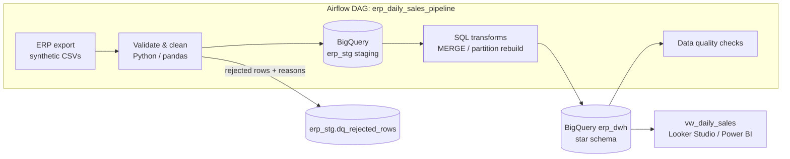

# ERP Sales Pipeline: Airflow → BigQuery Star Schema

An end-to-end batch data pipeline that simulates a nightly ERP (SAP/Uyumsoft-style) sales export, validates it, loads it into **BigQuery**, models it as a **star schema**, and runs **data quality checks**, orchestrated by **Apache Airflow** in Docker.

All data is synthetic and generated by the project. No real company data is used.

## Architecture



DAG tasks (in order): `extract_erp_data` → `validate_and_clean` → `load_to_bigquery_staging` → `build_star_schema` → `data_quality_checks`

## Data model (`erp_dwh`)

| Table | Type | Notes |
|---|---|---|
| `fact_sales` | Fact | Grain: one sales order line. Partitioned by `order_date`, clustered by `region, product_id`. Amounts in order currency and in TRY. |
| `dim_customer` | Dimension | Upserted with `MERGE` (latest snapshot wins). |
| `dim_product` | Dimension | Upserted with `MERGE`. |
| `dim_date` | Dimension | Calendar 2024–2030. |
| `vw_daily_sales` | View | Reporting layer for BI tools. Excludes cancelled orders. |

## Design decisions

- **Idempotent runs.** Staging loads delete the day's partition then append. The fact table deletes and re-inserts the day's partition. Re-running or backfilling a date never creates duplicates.
- **Rejected rows are kept, not dropped.** Every rejected record is stored with a reason (`duplicate_line`, `unknown_product`, `non_positive_quantity`, `missing_customer_id`, `invalid_order_date`, `orphan_line`, ...). The run fails if more than 5% of rows are rejected (`MAX_REJECT_RATE`).
- **Dirty data on purpose.** The generator injects about 1% bad records so the validation layer has real work to do.
- **Cost-aware BigQuery usage.** Day partitioning, clustering, and a 60-day expiration on staging partitions.
- **Post-load data quality checks** on the warehouse: row count, null keys, unique grain, orphan dimension keys, FX applied, no negative amounts. A failed check fails the Airflow task.
- **Deterministic data.** The same date always produces the same extract, which makes tests and backfills reproducible.

## Run it

### 1. Without GCP (dry run, about 10 seconds)
```bash
python -m venv .venv && source .venv/bin/activate
pip install -r requirements.txt
PYTHONPATH=src python -m erp_pipeline.cli --ds 2026-11-16 --dry-run
PYTHONPATH=src pytest
```

### 2. With BigQuery and Airflow (Docker)
1. Create a GCP project and enable the BigQuery API.
2. Create a service account with roles **BigQuery Data Editor** and **BigQuery Job User**. Download its JSON key to `secrets/service_account.json` (the `secrets/` folder is git-ignored).
3. `cp .env.example .env` and set `GCP_PROJECT_ID`.
4. Start Airflow:
   ```bash
   docker compose up --build
   ```
5. Open http://localhost:8080. The admin password is printed in the container logs (`docker compose logs airflow | grep -i password`).
6. Trigger the `erp_daily_sales_pipeline` DAG. To backfill, trigger it with different logical dates.
7. Query the result:
   ```sql
   SELECT * FROM `YOUR_PROJECT.erp_dwh.vw_daily_sales` ORDER BY order_date DESC LIMIT 100;
   ```

You can also run the full pipeline without Airflow: `PYTHONPATH=src python -m erp_pipeline.cli --ds 2026-11-16` (needs `GCP_PROJECT_ID` and credentials).

## Repository layout

```
dags/erp_daily_pipeline.py   Airflow DAG
src/erp_pipeline/            generate_data, transform (validation), bq (helpers), checks (DQ), pipeline, cli
sql/                         DDL, dimension MERGEs, fact rebuild, reporting view
tests/                       pytest tests for generation and validation
docker-compose.yml           Local Airflow (standalone mode)
```

## Limitations and next steps

- Local Airflow uses `standalone` mode (SQLite) for development. Production would use Postgres + Celery/Kubernetes executor or Cloud Composer.
- Intermediate files live on a local volume. A production version would land them in Cloud Storage.
- Dimensions are SCD Type 1. SCD Type 2 for customers would preserve history.
- Possible additions: dbt for the SQL layer, Terraform for datasets and IAM, CI with GitHub Actions (lint + tests), a Looker Studio dashboard screenshot.
